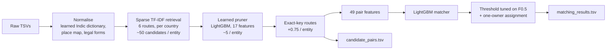

# Business Entity Resolution at Scale

Matching ~10 million noisy business records from two sources to 1.7 million reference entities, across the US, India and a country never seen in training (France).

**Amazon ML Challenge 2026** (72-hour hackathon on Unstop, September 2026). Team **BTards**: [Mayank Singh](https://github.com/246mayank) and [Yash Anand](https://github.com/Yashanand13).
**Public leaderboard: macro F0.5 = 0.96601.**

---

## The problem

Three independent sources describe the same businesses, but share no identifiers:

- **Source 1:** a clean, deduplicated reference list (2.2M train / 1.7M test entities).
- **Sources 2 and 3:** ~10M records per split (train and test), with heavy noise:
  - typos and digit-for-letter swaps (`Precisi0n`)
  - names in Devanagari, Tamil, Kannada and other Indic scripts
  - legal forms moved to the front (`Pvt. X Ltd.`)
  - names squashed into web domains
  - shuffled and abbreviated addresses, perturbed house numbers
  - planted **distractor records**: near-copies of real businesses that belong to no one

For every Source 1 entity, the system returns the Source 2/3 records that refer to it (possibly none).

The score is **macro F0.5** per entity, so precision counts twice as much as recall, and every entity, including those with no match, weighs the same. The submitted candidate set also counts: smaller candidate sets per entity rank higher.

## Results

| Version | Validation F0.5 | Public leaderboard |
|---|---|---|
| Sparse retrieval + LightGBM matcher (33 features) | 0.9415 | 0.935 |
| + learned candidate pruning, address-number features (39) | 0.9580 | 0.9504 |
| + exact-key candidate routes | 0.9635 | 0.9563 |
| + first-token and relative-to-best features (46) | 0.9669 | 0.9598 |
| + house-number + street-word route | 0.9680 | 0.9604 |
| + 40% of training entities, name-noise features (49) | 0.9725 | 0.9655 |
| **+ 60% of training entities (final)** | **0.9730** | **0.96601** |

Validation is a held-out 20% of training entities scored at full data density. It tracked the leaderboard within ~0.007 throughout.

## How it works



1. **Normalisation** (`normalize.py`). Everything is folded to lowercase ASCII, junk and honorifics are stripped, and legal forms and DBA aliases are split out. Two dictionaries are **learned from training labels only**, with no external data:
   - an Indic-script → English token map (1,236 tokens)
   - a per-country place-variant map (94 variants, e.g. `mh` → `maharashtra`)
2. **Retrieval** (`blocking.py`). Per-country sparse TF-IDF top-K search (`sparse_dot_topn`) over six routes: name, address, combined, combined within each shared place, character 4-grams for squashed names, and a reverse search (record → best entities). This turns a 10M × 2M cross-product into ~50 candidates per entity at 94.5% pair recall.
3. **Learned pruning** (`prune.py`). A small LightGBM model on 17 cheap signals keeps ≤ 10 candidates per entity. Candidates drop ~10× (108M → ~11M pairs) with no measurable F0.5 loss.
4. **Exact-key routes** (`keyroute.py`). Retrieval drops tokens that appear in more than 3,000 records for speed. So "behavioral health clinic, 132 highway 89 mayflower ar" was searched as just "mayflower", and its identical copies were missed. Join-based routes fix this: same name + place, same address, same house number + place, same house number + street word, same name for address-less records. Pair recall rose from 0.943 to 0.964 (+0.006 on the leaderboard).
5. **Matcher** (`features.py`, `train.py`). LightGBM over 49 pair features:
   - fuzzy and TF-IDF name/address similarity
   - house-number and number-set agreement
   - first-token swap and "novel real word" signals aimed at distractor copies
   - candidate-context features expressed as differences, not raw counts
6. **Decision** (`predict.py`). The threshold is tuned directly on macro F0.5 (singletons included). Each Source 2/3 record is then assigned only to its single most likely entity, since in the data every record belongs to at most one entity.

Country is never used as a feature, so France, which appears only in test, is handled like the other countries.

## Engineering highlights

- **Data contracts between stages** (`contracts.py`): typed Parquet schemas with ID-existence, same-country and one-owner validators. They let two people build separate stages in parallel.
- **Streams in 16 GB of RAM**: sharded feature building, batched scoring and 64-bit pair hashing. The same code ran on a laptop and on an AWS EC2 r6i.2xlarge.
- **A pre-upload drift gate.** Before any leaderboard upload, the test prediction rate per country is compared with the validation rate of the same model. It caught a model that gained +0.003 on validation but scored 0.92 on the leaderboard: its count-based features took values on test never seen in training, because test has more records per entity.
- **Reproducible**: deterministic ID-based sampling, pinned dependencies, 69 unit tests, and a README that regenerates both submission files from raw data.

## Repository layout

```
code/business_entity_resolution/   the pipeline: src/, tests/, README (exact reproduction steps), requirements
Documentation_template.md          full methodology write-up submitted with the solution
docs/method/                       retrieval and matching design notes
docs/experiments/                  experiment logs (what was tried, what was kept)
docs/submissions_log.md            every leaderboard submission with validation score and checksums
docs/REPRODUCE.md                  clean-clone reproduction checklist
notebooks/A_01_text_eda.ipynb      exploratory analysis (outputs stripped)
make_submission.{ps1,sh}           validate and package the submission zip
```

## Running it

The competition data is not included (it belongs to the organisers). With the challenge's `dataset/` folder placed next to `code/`:

```bash
cd code/business_entity_resolution
pip install -r requirements.txt
python -m pytest -q tests
```

The full end-to-end commands and timings are in [`code/business_entity_resolution/README.md`](code/business_entity_resolution/README.md).

## Team

| | Owned |
|---|---|
| **Mayank Singh** | normalisation, retrieval, learned pruning, exact-key routes, data contracts, pipeline orchestration, AWS runs, submission gating |
| **Yash Anand** | pair features, LightGBM matcher, threshold tuning and one-owner decision, packaging scripts |

Error analysis and experiment design were shared.

## License

[MIT](LICENSE). The competition data and the organisers' problem statement and validator are not part of this repository.
